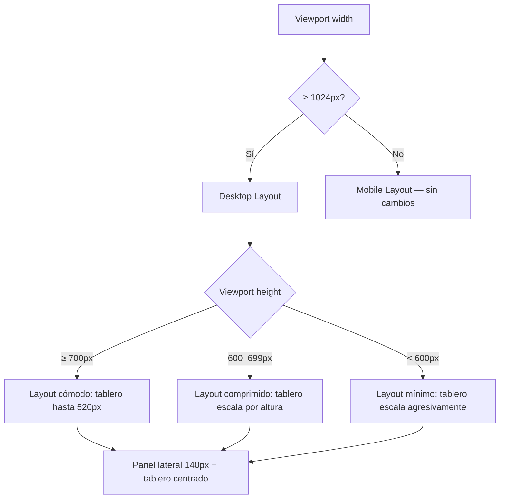
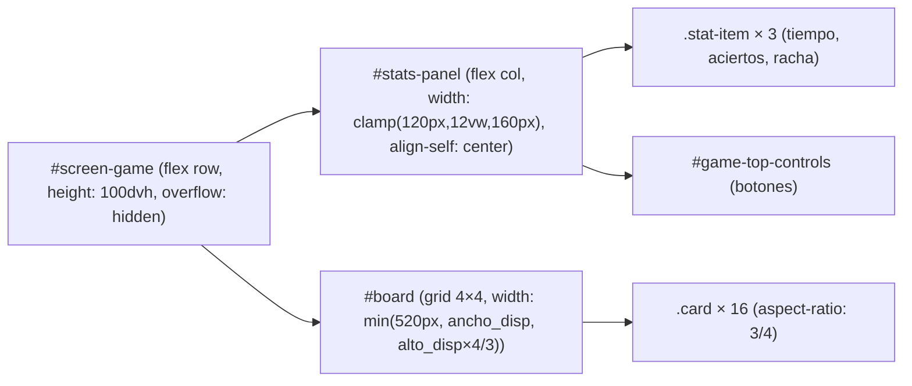
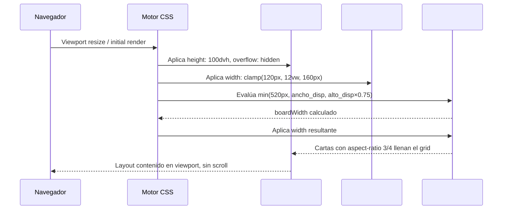

# Design Document: Desktop Responsive Layout

## Overview

El juego Memorama Arcade Retro funciona correctamente en mobile pero en ventanas de escritorio pequeñas (sin pantalla completa) el tablero 4×4 se desborda o queda cortado, haciendo el juego injugable. Esta feature corrige el layout de `#screen-game` para que el tablero y el panel de estadísticas siempre quepan en el viewport visible en cualquier tamaño de ventana desktop (≥1024px), usando CSS responsivo con `clamp()`, `min()`, `max()` y viewport units, sin modificar la lógica de juego ni el layout mobile existente.

**Alcance:** Cambios exclusivamente en el bloque `<style>` de `index.html`. No se toca ningún motor JS, animación flip, ni el layout mobile (< 1024px) que ya funciona bien.

---

## Architecture

### Diagrama de Breakpoints



### Estrategia de Escalado

El problema central en desktop pequeño es que el tablero tiene un ancho fijo (`min(520px, ...)`) que no considera la **altura** disponible. En una ventana 1024×600px, el tablero de 520px de ancho produce cartas de `520/4 = 130px` de ancho y `130 × 4/3 ≈ 173px` de alto, dando un tablero de `173×4 + gaps ≈ 720px` de alto — mucho más que los ~540px útiles disponibles.

**Solución:** Calcular el ancho del tablero como el mínimo entre:
1. El ancho máximo deseado (520px)
2. El ancho disponible descontando el panel lateral y los gaps
3. **El alto disponible × (4/3)** — la inversa del aspect-ratio de las cartas, para que el tablero nunca supere el alto del viewport

```
ancho_tablero = min(
  520px,                                          -- máximo absoluto
  100vw - panel_width - gaps,                     -- restricción horizontal
  (100vh - padding_vertical) × (4/3)              -- restricción vertical ← clave
)
```

---

## Components and Interfaces

### Componentes CSS Afectados

| Selector | Problema actual | Cambio requerido |
|---|---|---|
| `#screen-game` (≥1024px) | `padding: clamp(3rem, 5vw, 4rem)` top — demasiado en ventanas bajas | Reducir padding top con `clamp` más agresivo |
| `#board` (≥1024px) | `width: min(520px, calc(100vw - panel - 6rem))` — no considera altura | Agregar restricción de altura: `min(..., calc((100vh - padding_v) * 4/3))` |
| `#stats-panel` (≥1024px) | `gap: clamp(0.75rem, 2vw, 1.5rem)` — gaps grandes en ventanas bajas | Reducir gap con `clamp` sensible a `vh` |
| `.stat-value` (≥1024px) | `font-size: clamp(1rem, 3.5vw, 1.75rem)` — no escala por altura | Agregar restricción `min()` con `vh` |
| `#board` (1024–1280px) | Sin breakpoint intermedio para ventanas medianas | Agregar `@media (min-width: 1024px) and (max-width: 1280px)` |
| `#board` (desktop bajo, <700px alto) | Sin regla para viewports bajos | Agregar `@media (min-width: 1024px) and (max-height: 699px)` |

### Jerarquía de Contenedores (Desktop)



---

## Data Models

No se introducen nuevos modelos de datos. Todos los cambios son declaraciones CSS puras.

### Variables CSS Nuevas (opcionales, para mantenibilidad)

```css
:root {
  /* Padding vertical total en desktop (top + bottom) */
  --game-padding-v-desktop: clamp(1.5rem, 4vh, 3rem);
  /* Padding horizontal total en desktop (izq + der) */
  --game-padding-h-desktop: clamp(1rem, 3vw, 2rem);
  /* Ancho del panel de stats en desktop */
  --stats-panel-width: clamp(120px, 12vw, 160px);
  /* Gap entre panel y tablero en desktop */
  --game-gap-desktop: clamp(1rem, 2vw, 2rem);
}
```

---

## Algorithmic Pseudocode

### Algoritmo de Cálculo de Dimensiones del Tablero (Desktop)

```pascal
ALGORITHM calcBoardWidth_Desktop
INPUT:
  vw := window.innerWidth          -- ancho del viewport en px
  vh := window.innerHeight         -- alto del viewport en px
OUTPUT:
  boardWidth := ancho CSS del #board en px

BEGIN
  -- Constantes del layout desktop
  panelWidth    := CLAMP(120, 0.12 * vw, 160)   -- ancho del #stats-panel
  paddingH      := CLAMP(16, 0.03 * vw, 32) * 2 -- padding horizontal total (izq + der)
  gapH          := CLAMP(16, 0.02 * vw, 32)      -- gap entre panel y tablero
  paddingV      := CLAMP(24, 0.04 * vh, 48) * 2  -- padding vertical total (top + bottom)

  -- Restricción 1: ancho máximo absoluto
  maxAbsolute := 520

  -- Restricción 2: ancho disponible horizontalmente
  availableWidth := vw - panelWidth - paddingH - gapH

  -- Restricción 3: ancho máximo para que el tablero quepa en altura
  -- Cada carta tiene aspect-ratio 3/4, el tablero tiene 4 filas
  -- boardHeight = boardWidth * (4/3)  →  boardWidth = boardHeight * (3/4)
  -- boardHeight ≤ vh - paddingV
  -- Por tanto: boardWidth ≤ (vh - paddingV) * (3/4)
  availableHeight := vh - paddingV
  maxByHeight := availableHeight * (3 / 4)

  -- Resultado: el mínimo de las tres restricciones
  boardWidth := MIN(maxAbsolute, availableWidth, maxByHeight)

  ASSERT boardWidth > 0
  ASSERT boardWidth * (4/3) + paddingV <= vh   -- tablero cabe en altura
  ASSERT boardWidth + panelWidth + paddingH + gapH <= vw  -- tablero cabe en ancho

  RETURN boardWidth
END
```

**Precondiciones:**
- `vw >= 1024` (solo aplica en desktop)
- `vh >= 400` (viewport mínimo razonable)

**Postcondiciones:**
- `boardWidth <= 520` (no supera el máximo estético)
- `boardWidth * (4/3) <= vh - paddingV` (tablero cabe verticalmente)
- `boardWidth + panelWidth + paddingH + gapH <= vw` (tablero cabe horizontalmente)

**Loop Invariants:** N/A (no hay bucles)

---

### Algoritmo de Reducción de Padding Vertical (Desktop)

```pascal
ALGORITHM calcPaddingVertical_Desktop
INPUT:
  vh := window.innerHeight
OUTPUT:
  paddingTop, paddingBottom en rem

BEGIN
  -- En ventanas altas (≥ 800px): padding generoso
  IF vh >= 800 THEN
    paddingTop    := CLAMP(2rem, 4vh, 3.5rem)
    paddingBottom := CLAMP(1rem, 2vh, 2rem)

  -- En ventanas medias (600–799px): padding reducido
  ELSE IF vh >= 600 THEN
    paddingTop    := CLAMP(1rem, 3vh, 2rem)
    paddingBottom := CLAMP(0.75rem, 2vh, 1.5rem)

  -- En ventanas bajas (< 600px): padding mínimo
  ELSE
    paddingTop    := CLAMP(0.5rem, 2vh, 1rem)
    paddingBottom := CLAMP(0.5rem, 1.5vh, 0.75rem)
  END IF

  RETURN paddingTop, paddingBottom
END
```

---

## Key Functions with Formal Specifications

### Regla CSS Principal: `#board` en Desktop

```css
/* Restricción combinada: ancho, disponibilidad horizontal y disponibilidad vertical */
@media (min-width: 1024px) {
  #board {
    width: min(
      520px,
      calc(100vw - clamp(120px, 12vw, 160px) - clamp(2rem, 6vw, 4rem)),
      calc((100vh - clamp(3rem, 8vh, 6rem)) * 0.75)
    );
  }
}
```

**Precondiciones:**
- Viewport `width >= 1024px`
- `#screen-game` tiene `height: 100dvh` y `overflow: hidden`

**Postcondiciones:**
- `#board.offsetWidth <= 520` siempre
- `#board.offsetHeight <= 100vh - padding_vertical` siempre
- El tablero no produce scroll en `#screen-game`

---

### Regla CSS: `#screen-game` Padding Desktop Adaptativo

```css
@media (min-width: 1024px) {
  #screen-game {
    padding: clamp(1rem, 4vh, 3.5rem) clamp(1rem, 3vw, 2rem) clamp(0.75rem, 2vh, 2rem);
    height: 100dvh;
    overflow: hidden;
  }
}

/* Ventanas bajas: reducir padding agresivamente */
@media (min-width: 1024px) and (max-height: 699px) {
  #screen-game {
    padding: clamp(0.5rem, 2vh, 1rem) clamp(1rem, 2vw, 1.5rem) clamp(0.5rem, 1.5vh, 0.75rem);
  }
}
```

**Precondiciones:**
- Viewport `width >= 1024px`

**Postcondiciones:**
- Padding total vertical ≤ `0.15 * vh` en viewports bajos
- Padding total vertical ≤ `0.12 * vh` en viewports muy bajos (< 600px)

---

### Regla CSS: `#stats-panel` Gap Adaptativo en Desktop

```css
@media (min-width: 1024px) {
  #stats-panel {
    gap: clamp(0.4rem, 1.5vh, 1.25rem);
    padding: clamp(0.5rem, 1.5vh, 1rem) clamp(0.75rem, 1.5vw, 1.25rem);
  }
}

@media (min-width: 1024px) and (max-height: 699px) {
  #stats-panel {
    gap: clamp(0.25rem, 1vh, 0.5rem);
    padding: clamp(0.35rem, 1vh, 0.6rem) clamp(0.5rem, 1vw, 0.75rem);
  }
}
```

---

## Example Usage

### Caso 1: Ventana 1024×600px (el caso más problemático)

```pascal
-- Inputs
vw := 1024
vh := 600

-- Cálculos
panelWidth    := CLAMP(120, 0.12 * 1024, 160) = 122.88 ≈ 123px
paddingH      := CLAMP(16, 0.02 * 1024, 32) * 2 = 40.96 ≈ 41px × 2 = 82px
gapH          := CLAMP(16, 0.02 * 1024, 32) = 20.48 ≈ 20px
paddingV      := CLAMP(8, 0.02 * 600, 16) * 2 = 12px × 2 = 24px

availableWidth := 1024 - 123 - 82 - 20 = 799px
maxByHeight    := (600 - 24) * 0.75 = 576 * 0.75 = 432px

boardWidth := MIN(520, 799, 432) = 432px

-- Verificación
boardHeight := 432 * (4/3) = 576px
totalHeight := 576 + 24 = 600px = vh ✓  -- cabe exactamente
totalWidth  := 432 + 123 + 82 + 20 = 657px < 1024px ✓
```

### Caso 2: Ventana 1280×700px

```pascal
vw := 1280, vh := 700
panelWidth := 153px, paddingH := 64px, gapH := 25px, paddingV := 42px

availableWidth := 1280 - 153 - 64 - 25 = 1038px
maxByHeight    := (700 - 42) * 0.75 = 658 * 0.75 = 493px

boardWidth := MIN(520, 1038, 493) = 493px  -- restricción de altura activa
boardHeight := 493 * (4/3) = 657px ≤ 658px ✓
```

### Caso 3: Ventana 1920×1080px (desktop grande — sin cambios)

```pascal
vw := 1920, vh := 1080
panelWidth := 160px, paddingH := 64px, gapH := 32px, paddingV := 96px

availableWidth := 1920 - 160 - 64 - 32 = 1664px
maxByHeight    := (1080 - 96) * 0.75 = 984 * 0.75 = 738px

boardWidth := MIN(520, 1664, 738) = 520px  -- restricción absoluta activa
-- Comportamiento idéntico al original ✓
```

---

## Architecture — Diagrama de Secuencia de Renderizado



---

## Error Handling

### Escenario 1: Viewport extremadamente pequeño (< 400px alto en desktop)

**Condición:** Ventana redimensionada a menos de 400px de alto con ancho ≥ 1024px.

**Respuesta:** El tablero escala al mínimo funcional. Con `vh = 400` y `paddingV = 16px`:
- `maxByHeight = (400 - 16) * 0.75 = 288px`
- Cartas de `288/4 = 72px` de ancho — jugable aunque pequeño.

**Recuperación:** Al agrandar la ventana, el tablero escala automáticamente hacia arriba.

---

### Escenario 2: Viewport 1024px exacto de ancho con panel lateral

**Condición:** Ancho mínimo del breakpoint desktop con panel lateral visible.

**Respuesta:** Con `vw = 1024`:
- `panelWidth = 123px`, `paddingH = 82px`, `gapH = 20px`
- `availableWidth = 1024 - 123 - 82 - 20 = 799px`
- La restricción de altura domina en ventanas bajas, la de ancho en ventanas altas.

**Recuperación:** El layout siempre es válido en este breakpoint.

---

### Escenario 3: Zoom del navegador al 150%

**Condición:** El usuario aplica zoom, reduciendo el viewport efectivo.

**Respuesta:** `vw` y `vh` en CSS reflejan el viewport con zoom aplicado. Las fórmulas `clamp()` y `min()` se recalculan automáticamente. El comportamiento es idéntico a una ventana más pequeña.

---

## Testing Strategy

### Unit Testing Approach

Verificar que las reglas CSS producen los valores correctos en los viewports problemáticos:

1. **1024×600px**: `#board.offsetWidth` debe ser ≤ 432px y `#board.offsetHeight` ≤ 576px.
2. **1280×700px**: `#board.offsetWidth` debe ser ≤ 493px.
3. **800×600px** (mobile breakpoint): layout mobile sin cambios — `#stats-panel` en fila horizontal.
4. **1920×1080px**: `#board.offsetWidth` debe ser exactamente 520px (sin cambio respecto al original).
5. **1024×768px**: `#board.offsetWidth` debe ser 520px (altura suficiente, restricción absoluta activa).

### Property-Based Testing Approach

**Property Test Library**: fast-check (JavaScript)

**Propiedad 1 — Tablero siempre cabe verticalmente:**
```
∀ vw ∈ [1024, 2560], vh ∈ [400, 1440]:
  boardHeight(vw, vh) + paddingV(vh) ≤ vh
```

**Propiedad 2 — Tablero siempre cabe horizontalmente:**
```
∀ vw ∈ [1024, 2560], vh ∈ [400, 1440]:
  boardWidth(vw, vh) + panelWidth(vw) + paddingH(vw) + gapH(vw) ≤ vw
```

**Propiedad 3 — Preservación en desktop grande:**
```
∀ vw ∈ [1440, 2560], vh ∈ [900, 1440]:
  boardWidth(vw, vh) = 520px  -- restricción absoluta siempre activa
```

**Propiedad 4 — Layout mobile sin cambios:**
```
∀ vw ∈ [320, 1023]:
  layout(vw) = layout_original(vw)  -- ninguna regla nueva aplica
```

### Integration Testing Approach

Pruebas visuales en Chrome DevTools con emulación de dispositivos:

| Viewport | Esperado |
|---|---|
| 1024×600 | Tablero y panel visibles, sin scroll |
| 1280×700 | Tablero y panel visibles, sin scroll |
| 1366×768 | Tablero 520px (sin cambio) |
| 1920×1080 | Tablero 520px (sin cambio) |
| 375×667 (mobile) | Layout mobile sin cambios |
| 768×1024 (tablet) | Layout mobile sin cambios |

---

## Performance Considerations

- Todos los cambios son declaraciones CSS puras — costo de renderizado O(1).
- Las funciones `clamp()` y `min()` son evaluadas por el motor CSS nativo, sin JavaScript adicional.
- No se agregan nuevos elementos DOM ni event listeners.
- El recálculo de layout ocurre solo en eventos `resize`, igual que antes.

---

## Security Considerations

No aplica — cambios puramente visuales/CSS sin interacción con datos de usuario, red o almacenamiento.

---

## Dependencies

- CSS `clamp()`, `min()`, `max()` — soportados en todos los navegadores modernos (Chrome 79+, Firefox 75+, Safari 13.1+, Edge 79+).
- CSS `100dvh` — soportado en Chrome 108+, Firefox 101+, Safari 15.4+. Fallback a `100vh` ya presente en el código.
- `@media (max-height: ...)` — soportado universalmente.
- No se requieren librerías externas ni cambios en el HTML.
